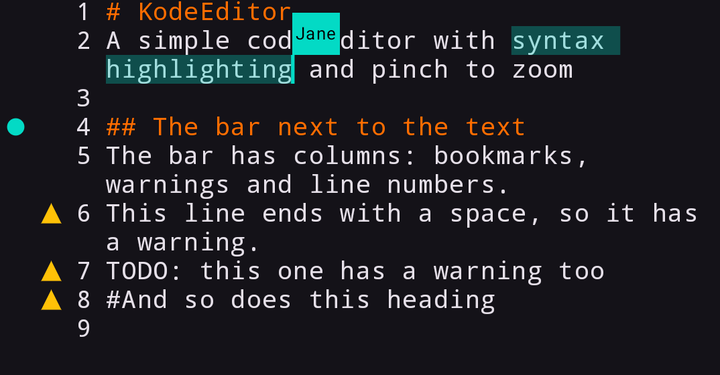

# KodeEditor
A fast code editor for Jetpack Compose, with syntax highlighting, line wrapping and pinch to zoom.



# Features
* Stays responsive with large documents, because only the visible lines are measured and drawn
* Pinch to zoom and fling
* Line wrapping
* Folding of whole sections and parts of lines, with Markdown built in and your own rules for other languages
* A bar next to the text with line numbers and your own columns, like warnings or bookmarks
* Syntax highlighting for many languages with [KodeHighlighter](https://github.com/markusressel/KodeHighlighter), or your own rules
* Hardware keyboard support, selection handles and a text menu
* Built for collaborative editing, with changes of other users and an overlay for their cursors
* Animations for all of this, which can be turned off

# Try the demo app
Every build of `master` publishes the demo app as a pre-release `build-<n>`, a release build with R8 that is signed
with the public key `.ci/debug.keystore`. The newest 5 are kept, and they are built from the current code, which can be
ahead of the latest library release.

The easiest way to install and update it is [Obtainium](https://github.com/ImranR98/Obtainium):

<a href="https://apps.obtainium.imranr.dev/redirect?r=obtainium://add/https://github.com/markusressel/KodeEditor"></a>

Open the link on the phone. Obtainium shows **Add App** with the address filled in. Turn on **Include prereleases**,
because the demo builds are pre-releases, then tap **Add** and **Install**. Everything else stays at its default. Without
the link, enter the address `https://github.com/markusressel/KodeEditor` in **Add App** yourself.

Without that switch Obtainium reports "Could not find a suitable release", because the library releases have no APK.
All builds have the same key and get a higher version code from CI, so they update each other, and Obtainium checks for
new builds and offers the update.

# Installation
The editor requires `minSdk` 24 and `compileSdk` 37. It is published through JitPack, so add that to your repositories:

```kotlin
repositories {
    maven { url = uri("https://jitpack.io") }
}
```

Then add the editor, and the [KodeHighlighter](https://github.com/markusressel/KodeHighlighter) module of each language
you need:

```kotlin
dependencies {
    implementation("com.github.markusressel:KodeEditor:7.0.0")
    implementation("com.github.markusressel.KodeHighlighter:markdown:6.0.0")
}
```

# Usage

```kotlin
var text by rememberSaveable(stateSaver = TextFieldValue.Saver) {
    mutableStateOf(TextFieldValue("# Hello KodeEditor"))
}

KodeEditor(
    modifier = Modifier.fillMaxSize(),
    languageRuleBook = MarkdownRuleBook(),
    colorScheme = DarkBackgroundColorSchemeWithSpanStyle(),
    text = text,
    onValueChange = { text = it },
    lineWrapping = true,
)
```

Have a look at the demo app (`app` module) for a complete sample.

## Options

| Parameter | Description | Default |
|---|---|---|
| `colors` | colors of the text and the bar, see `KodeEditorDefaults.editorColors()` | Material theme |
| `textStyle` | style of the text, a monospaced font makes line wrapping cheap | `LocalTextStyle.current` |
| `enabled` | whether the user can interact with the editor | `true` |
| `readOnly` | whether the text can be selected but not changed | `enabled.not()` |
| `lineWrapping` | whether long lines continue in the next row instead of scrolling sideways | `false` |
| `minZoom`, `maxZoom` | limits of the zoom | `0.25f`, `10f` |
| `keepCursorVisible` | whether the view follows the cursor while the user edits | `true` |
| `autoCorrect` | whether the keyboard may correct words on its own, it can still offer suggestions without this | `false` |
| `gutterColumns` | what [the bar next to the text](#the-bar-next-to-the-text) shows | line numbers |
| `animations` | what [the editor animates](#animations) | everything |
| `foldProvider` | what [can be folded](#folding) | nothing |
| `lineDecorations` | what [the editor shows on whole lines](#line-decorations) | nothing |
| `keyBindings` | what [the keys of a hardware keyboard](#keyboard) do | `KodeEditorDefaults.keyBindings` |
| `overlay` | [content on top of the text](#overlay) | nothing |
| `onTextLayout` | called with the `KodeEditorLayout` when the text changed | nothing |

## Syntax highlighting

`languageRuleBook` decides what is highlighted, and `colorScheme` how it looks. There is no detection of the language of
a document, so pass the rule book that fits. The available languages and how to write your own are described in
[KodeHighlighter](https://github.com/markusressel/KodeHighlighter).

## Large documents and collaborative editing

The editor keeps the text itself, in a `KodeEditorState`, and each change happens there directly on the main thread.
Hand the state to the editor instead of a `TextFieldValue` to avoid a second copy of the text. This is the fastest way
to use the editor, and changes can not overtake each other:

```kotlin
val state = rememberKodeEditorState(initialText)

DisposableEffect(state) {
    val listener = object : KodeEditorListener {
        // the user changed the text, this is called within the change
        override fun onLocalEdit(splice: TextSplice) = sync.send(splice)
    }
    state.addListener(listener)
    onDispose { state.removeListener(listener) }
}

// changes of other users, the cursor and the keyboard stay in the right place
state.applyRemote(splices)

KodeEditor(
    state = state,
    languageRuleBook = ruleBook,
    colorScheme = colorScheme,
)
```

All lines have the same height, so a style with a larger font size does not make its line taller.

## The bar next to the text

`gutterColumns` decides what the bar shows, from left to right. By default that is the line numbers. A column draws
one cell per line and can react to taps, which is enough for warning markers or bookmarks. Reading snapshot state in
`drawCell` draws the bar again when that state changes.

Columns work with line numbers, so markers that belong to a line have to move when an edit moves that line. The demo app
shows both kinds: `WarningColumn` computes its markers from the text, and `BookmarkColumn` keeps its own and moves them
with `LineEdit`.

```kotlin
class WarningColumn(private val warnings: SnapshotStateList<Int>) : KodeEditorGutterColumn {
    override fun width(lineCount: Int) = 48

    override fun DrawScope.drawCell(cell: GutterCell) {
        if (cell.line in warnings) drawCircle(Color.Yellow, 12f, Offset(cell.width / 2, cell.height / 2))
    }

    override fun onTap(line: Int): Boolean {
        // show the warning of this line
        return line in warnings
    }
}

KodeEditor(
    // ...
    gutterColumns = listOf(warningColumn, rememberLineNumberColumn(textStyle, colors)),
)
```

## Animations

The bar next to the text animates to a new width, the numbers of new and removed lines fade, and with line wrapping
everything moves to its new place when lines wrap differently. Each can be turned off:

```kotlin
KodeEditor(
    // ...
    animations = KodeEditorAnimations(reflow = false),
)
```

Folding moves what is below a fold to its new place and fades the lines of the fold, `folding = false` turns that off.
`KodeEditorAnimations.None` turns off all of them.

## Folding

`foldProvider` decides what can be folded, and adds a column with arrows to the end of the bar. Tap an arrow or the `⋯`
behind a folded line. The editor handles everything else, so only finding the regions depends on the language:

```kotlin
KodeEditor(
    // ...
    foldProvider = MarkdownFoldProvider,
)

// any other language
val braces = KodeEditorFoldProvider { text -> listOf(FoldRegion(startLine = 0, endLine = 3)) }
```

A folded line gets a background and a placeholder, their colors are `foldedLineBackgroundColor` and
`foldPlaceholderColor` of `KodeEditorColors`. Line numbers stay the same, the arrow keys skip folded text, and a cursor
that ends up in it or a change across its edge unfolds it. The folds are not saved with the text.

### Within a line

A provider can also show parts of a line as something shorter, in a box. The text itself stays what it is, so copying a
selection returns all of it. `MarkdownFoldProvider` does this for targets of links and images, long addresses, comments
and character references.

```kotlin
val addresses = object : KodeEditorFoldProvider {
    override fun foldRegions(text: String) = emptyList<FoldRegion>()

    // runs on another thread
    override fun inlineFolds(text: String) = listOf(InlineFold(start = 10, end = 60, placeholder = "example.com/…"))
}
```

Tapping the box or Ctrl + Plus shows the text, and it goes back when the cursor leaves or with Ctrl + Minus. The arrow keys
move over a box. A fold that the provider finds with another range, like while typing a link or next to one, stays open
until the cursor leaves the line, so the text does not jump around. Other changes leave a box closed. Backspace behind a
box or Delete in front of one only opens it, the next press removes text you can see. The colors are
`inlineFoldBackgroundColor` and `inlineFoldTextColor` of `KodeEditorColors`.

## Line decorations

`lineDecorations` shows something on whole lines: a background behind the selection and the text, text behind the end of
the line, or both. This fits a highlight of the current line, lines with errors, changed lines or notes next to the
code. Only visible lines are asked, and reading snapshot state in a decoration updates it when that state changes.

```kotlin
class ErrorLines(private val errors: SnapshotStateMap<Int, String>) : KodeEditorLineDecoration {
    override fun DrawScope.drawBackground(line: DecoratedLine) {
        if (line.line in errors) drawRect(Color.Red.copy(alpha = 0.15f), size = Size(line.width, line.height))
    }

    override fun trailingText(line: Int) = errors[line]?.let { AnnotatedString("  $it", SpanStyle(Color.Red)) }

    override fun onTrailingTextTap(line: Int): Boolean {
        // show the whole error of this line
        return line in errors
    }
}

KodeEditor(
    // ...
    lineDecorations = listOf(errorLines),
)
```

Decorations work with line numbers like the columns of the bar, so they have to move when an edit moves their line. To
mark a part of a line or to draw on top of the text, use the [overlay](#overlay).

## Overlay

Use the `overlay` parameter to draw on top of the editor text, e.g. the cursors and selections of other users.
The content moves with zoom and scroll and receives the `KodeEditorLayout` of the editor text:

```kotlin
KodeEditor(
    // ...
    overlay = { layout ->
        val cursorRect = layout.getCursorRect(remoteCursorIndex)
        Canvas(modifier = Modifier.matchParentSize()) {
            drawLine(Color.Red, cursorRect.topCenter, cursorRect.bottomCenter, strokeWidth = 2.dp.toPx())
        }
    },
)
```

## Keyboard

The editor works with hardware keyboards:

| Keys | Action |
|---|---|
| Arrow keys | move the cursor |
| Ctrl or Alt + Left/Right | move by word |
| Ctrl or Alt + Up/Down | move by paragraph |
| Page Up, Page Down | move by the visible height |
| Home, End | move to the start or end of the line, with Ctrl of the text |
| Shift + Enter | start a new line below the current one, without splitting it |
| Tab | insert a tab (in a read-only editor it moves the focus) |
| Ctrl + A, C, X, V | select all, copy, cut, paste |
| Ctrl + Z, Ctrl + Y or Ctrl + Shift + Z | undo, redo |
| Shift + Tab | move the focus out of the editor |
| Shift + a key to move the cursor | extend the selection |
| Ctrl + Plus, Minus | show or fold what is at the cursor, otherwise zoom in or out |
| Ctrl + 0 | reset the zoom |

The D-pad of a TV remote or a gamepad still moves the focus between the elements of the screen.

`KodeEditorDefaults.keyBindings` holds these as a list, to show them to the user or to change them with `keyBindings`.
The first binding that fits a key press counts, and a key without a binding is left to the rest of the app:

```kotlin
KodeEditor(
    state = state,
    languageRuleBook = ruleBook,
    colorScheme = colorScheme,
    keyBindings = listOf(
        KodeEditorKeyBinding(Key.D, KodeEditorKeyAction.DeleteWord, ctrl = true),
    ) + KodeEditorDefaults.keyBindings.filter { it.action != KodeEditorKeyAction.ExpandOrZoomIn },
)
```

# View based editor

The View based editor (`CodeEditorLayout`, `CodeEditorView`) was removed in 8.0.0. Version 7.0.0 is the last one that has
it, and its XML attributes and APIs are described in the
[README of 7.0.0](https://github.com/markusressel/KodeEditor/blob/7.0.0/README.md#add-to-your-layout).

# Contributing

GitHub is for social coding: if you want to write code, I encourage contributions through pull requests from forks
of this repository. Create GitHub tickets for bugs and new features and comment on the ones that you are interested in.

# License

```
MIT License

Copyright (c) 2018 Markus Ressel

Permission is hereby granted, free of charge, to any person obtaining a copy
of this software and associated documentation files (the "Software"), to deal
in the Software without restriction, including without limitation the rights
to use, copy, modify, merge, publish, distribute, sublicense, and/or sell
copies of the Software, and to permit persons to whom the Software is
furnished to do so, subject to the following conditions:

The above copyright notice and this permission notice shall be included in all
copies or substantial portions of the Software.

THE SOFTWARE IS PROVIDED "AS IS", WITHOUT WARRANTY OF ANY KIND, EXPRESS OR
IMPLIED, INCLUDING BUT NOT LIMITED TO THE WARRANTIES OF MERCHANTABILITY,
FITNESS FOR A PARTICULAR PURPOSE AND NONINFRINGEMENT. IN NO EVENT SHALL THE
AUTHORS OR COPYRIGHT HOLDERS BE LIABLE FOR ANY CLAIM, DAMAGES OR OTHER
LIABILITY, WHETHER IN AN ACTION OF CONTRACT, TORT OR OTHERWISE, ARISING FROM,
OUT OF OR IN CONNECTION WITH THE SOFTWARE OR THE USE OR OTHER DEALINGS IN THE
SOFTWARE.
```
